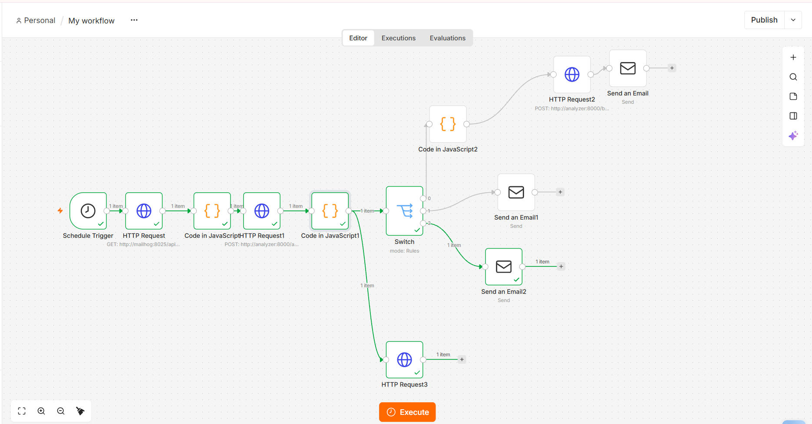

# Phishing SOAR : analyse et réponse automatisées aux e-mails suspects

Mini-SOAR de bout en bout, 100 % local, qui récupère les e-mails signalés par les utilisateurs, les analyse (règles, enrichissement VirusTotal et RDAP, corrélation de signaux), décide d'un verdict et déclenche une réponse automatique.

**Stack** : n8n · FastAPI · Mailhog · VirusTotal API · RDAP · Docker Compose

> Projet de laboratoire à but pédagogique (Blue Team / SOC). Il ne remplace pas une passerelle e-mail de production.

## Démo

<!-- Remplace par ta vidéo (lien YouTube non répertorié ou fichier glissé dans l'éditeur GitHub) -->
[Voir la démo vidéo](docs/demo.mp4)



## Architecture

```
Mailhog (boîte phishing-report@lab.local)
        │  toutes les minutes
        ▼
 n8n : Schedule Trigger → récupération des mails (API Mailhog)
        │
        ▼
 n8n : extraction de chaque mail (1 item par mail)
        │
        ▼
 FastAPI /analyze : parsing, URLs, pièces jointes, règles,
                    VirusTotal (URLs + hash de fichiers), âge du domaine (RDAP)
        │
        ▼
 n8n : score final + corrélation de signaux + planchers de gravité
        │
        ├── MALICIOUS  → blocage des domaines (FastAPI /block) → alerte SOC
        ├── SUSPICIOUS → mise en file d'attente → mail à l'analyste
        └── BENIGN     → rapport à l'utilisateur
        │
        ▼
 Suppression du mail traité dans Mailhog (évite le retraitement)
```

## Fonctionnement de la détection

### 1. Règles techniques (FastAPI)

| Règle | Points | Déclencheur |
|---|---|---|
| `pressure_words` | +5 | au moins 2 mots d'urgence ou de pression (texte normalisé, sans accents) |
| `lookalike_domain` | +15 | domaine imitant une marque (inclusion ou distance de Levenshtein) |
| `risky_attachment` | +10 | extension à risque ou double extension |
| `known_malware` | +40 | hash de la pièce jointe connu de VirusTotal (≥ 5 moteurs) |
| `auth_fail` | +15 | `spf=fail` ou `dkim=fail` dans `Authentication-Results` |
| `reply_to_mismatch` | +10 | `Reply-To` différent de `From` |

### 2. Enrichissement

- **VirusTotal** : réputation des URLs hors allowlist et des hash de pièces jointes (avec cache pour ménager le quota gratuit).
- **RDAP** : âge du domaine (domaine de moins de 7 jours : +20 dans n8n).

### 3. Décision (n8n)

- **Corrélation de signaux** : exécutable + faux domaine, ou faux domaine + Reply-To détourné, font monter le score à un minimum (75 et 65).
- **MALICIOUS** : score ≥ 60 **et** au moins 2 familles de signaux distinctes, ou malware connu de VirusTotal.
- **SUSPICIOUS** : score ≥ 30, ou score ≥ 20 avec au moins 2 familles de signaux.
- **Plancher de gravité** : une pièce jointe exécutable ne peut jamais être classée BENIGN.
- **Confiance** : `High` uniquement si le verdict repose sur une preuve technique ; un BENIGN sans aucun signal vérifiable reste en `Low`.

### 4. Réponse automatisée

- Les domaines malveillants sont ajoutés à `blocklist/domains.txt` (les domaines de l'allowlist sont protégés).
- Alerte envoyée à l'analyste, avec sujet, expéditeur, score et raisons.
- Les mails ambigus sont mis en file d'attente pour une revue manuelle.
- Chaque mail est supprimé de la boîte après traitement.

## Installation

### Prérequis

- Docker et Docker Compose
- Python 3.10+ (uniquement pour lancer les mails de test)
- Une clé API VirusTotal gratuite

### Lancement

```bash
git clone <url-du-repo>
cd phishing_soar
cp .env.example .env        # puis renseigne VT_API_KEY
docker compose up -d --build
```

| Service | URL |
|---|---|
| n8n | http://localhost:5678 |
| Mailhog (interface web) | http://localhost:8025 |
| Mailhog (SMTP) | localhost:1025 |
| Analyzer (docs FastAPI) | adapte le port à ton `docker-compose.yml` |

### Configuration de n8n

1. Importe `n8n/workflow.json` (Workflows, puis Import from file).
2. Crée les credentials SMTP : hôte `mailhog`, port `1025`, sans authentification, sans SSL.
3. Dans `Code in JavaScript1`, vérifie que le mode est **Run Once for Each Item**.
4. Active le workflow.

## Tests

`tests/tests.py` envoie 4 e-mails de démonstration vers Mailhog, auxquels s'ajoute le mail EICAR avec pièce jointe `.exe`.

```bash
python tests/tests.py
```

| Cas | Verdict attendu | Pourquoi |
|---|---|---|
| Pièce jointe EICAR (`.exe`) | MALICIOUS | hash connu de VirusTotal (66 moteurs lors du test) |
| Typosquatting + Reply-To externe + SPF/DKIM en échec | MALICIOUS | corrélation de plusieurs familles de signaux |
| Faux domaine + mots de pression | SUSPICIOUS | 2 signaux, score modéré |
| Mail interne normal | BENIGN (confiance Low) | aucun signal |
| Invitation Google Meet | BENIGN | domaine dans l'allowlist |

## Structure du dépôt

```
phishing_soar/
├── analyzer/            # API FastAPI (analyse, enrichissement, blocage)
├── n8n/workflow.json    # workflow exporté
├── test.py       # e-mails de démonstration
├── docs/                # captures et vidéo
├── docker-compose.yml
├── .env.example
└── README.md
```

## Limites connues

- **Angles morts des règles** : un mail avec seulement un Reply-To différent et quelques mots de pression (peu de signaux, score faible) peut être classé BENIGN.
- **Pas d'analyse sémantique** : le corps du message n'est évalué que par mots-clés. Un LLM comme couche supplémentaire est une évolution envisagée ; il pourrait relever un mail en SUSPICIOUS mais ne devrait jamais déclencher seul un blocage, le contenu d'un mail étant une entrée non fiable (injection de prompt).
- **VirusTotal gratuit** : 4 requêtes par minute et 500 par jour ; une URL inconnue de VirusTotal n'est pas forcément saine.
- **Blocage local** : la blocklist est un fichier texte, non relié à un pare-feu ou à un proxy.
- **Traitement par polling** : un passage par minute, sans traitement en temps réel.
- **Environnement de labo** : Mailhog remplace un vrai serveur de messagerie.

## Pistes d'amélioration

- Couche LLM (Groq) pour détecter l'ingénierie sociale, avec fusion prudente des verdicts.
- Détection des liens HTML dont le texte affiché diffère de la destination.
- Analyse des pièces jointes en sandbox.
- Export des IOC vers un SIEM ou une plateforme de threat intelligence (MISP).
- Boucle de retour de l'analyste pour ajuster les seuils.

## Sécurité

- Aucune clé n'est versionnée : `VT_API_KEY` se trouve dans `.env`, ignoré par Git.
- Les exports n8n ne contiennent que des références aux credentials, jamais les secrets.

## Auteure

Hajer Benghazi, étudiante en génie informatique (FST), spécialisée en cybersécurité Blue Team / SOC.
